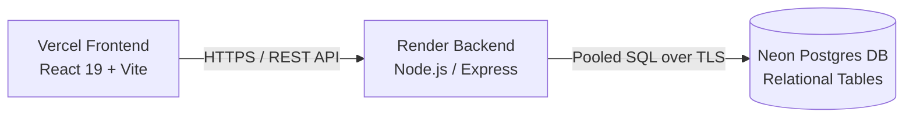

# NRBFIT Fitness Studio — Full-Stack Platform

NRBFIT is a modern full-stack web application for a Nairobi fitness studio. It features an interactive class schedule, coaching roster, membership packages, member authentication with session cookies, class slot bookings, and database-persisted customer enquiries.

---

## Live Deployment URLs

- **Frontend (Vercel)**: [https://nrbfit.vercel.app](https://nrbfit.vercel.app)
- **Backend API (Render)**: [https://nrbfit-api.onrender.com/api](https://nrbfit-api.onrender.com/api)
- **API Health Check**: [https://nrbfit-api.onrender.com/api/health](https://nrbfit-api.onrender.com/api/health)
- **Database**: [Neon Serverless PostgreSQL](https://neon.tech)

---

## Architecture Overview



- **Client (`client/`)**: Pure JavaScript React 19 SPA built with Vite and Tailwind CSS. Centralized API client with credentials support and automatic offline fallback to bundled studio data.
- **Server (`server/`)**: Express REST API with bcrypt password hashing, HttpOnly JWT cookies, and centralized error handling.
- **Database (`server/scripts/migrate.js`)**: Neon Serverless PostgreSQL with normalized tables: `users`, `coaches`, `classes`, `memberships`, `bookings`, and `enquiries`.

---

## Local Development & Live Preview

Run both frontend and backend concurrently from the root directory:

```bash
# 1. Install workspace dependencies
npm install

# 2. Run backend and frontend concurrently
npm run dev
```

- **Frontend Live Preview**: [http://localhost:5173](http://localhost:5173)
- **Backend API Server**: [http://localhost:5000/api](http://localhost:5000/api)
- **API Health Check**: [http://localhost:5000/api/health](http://localhost:5000/api/health)
- **Check Task Progress**: `npm run tasks`

---

## Deployment Configuration & Environment Variables

### 1. Render Backend Deployment (`server/`)
- **Root Directory**: `server`
- **Build Command**: `npm ci`
- **Start Command**: `npm start`
- **Health Check Path**: `/api/health`
- **Environment Variables**:
  - `NODE_ENV`: `production`
  - `PORT`: `5000` (or dynamically assigned by Render)
  - `DATABASE_URL`: `postgresql://<user>:<password>@<neon-host>/neondb?sslmode=require`
  - `JWT_SECRET`: `<secure-random-jwt-secret>`
  - `CLIENT_URL`: `https://nrbfit.vercel.app`

### 2. Vercel Frontend Deployment (`client/`)
- **Build Command**: `npm run build:client` (or Vite preset `npm run build` if root is `client`)
- **Output Directory**: `client/dist` (or `dist` if root is `client`)
- **Install Command**: `npm install --prefix client`
- **Environment Variables**:
  - `VITE_API_URL`: `https://nrbfit-api.onrender.com/api`

---

## Assessment Presentation Demo Steps

1. **Verify Backend Health**:
   Open `https://nrbfit-api.onrender.com/api/health` (or local `http://localhost:5000/api/health`) to confirm `{ status: "ok" }`.
2. **Explore Timetable & Coaches**:
   Navigate the classes schedule and filter by category (Strength, Conditioning, Pilates). Data is pulled dynamically from Neon Postgres.
3. **Register New Member**:
   Click **"Sign In"** in the navigation header, switch to **"Create Account"**, and sign up. An HttpOnly cookie session is issued and your name appears in the header.
4. **Reserve a Class Slot**:
   Scroll to the schedule and click **"Book"** on any session. The booking is persisted to the Postgres `bookings` table with slot capacity checks.
5. **Submit Studio Enquiry**:
   Scroll to **"Talk to the studio"**, fill in the contact form, and click **"Send enquiry"**. The submission is persisted directly to the Postgres `enquiries` table.
