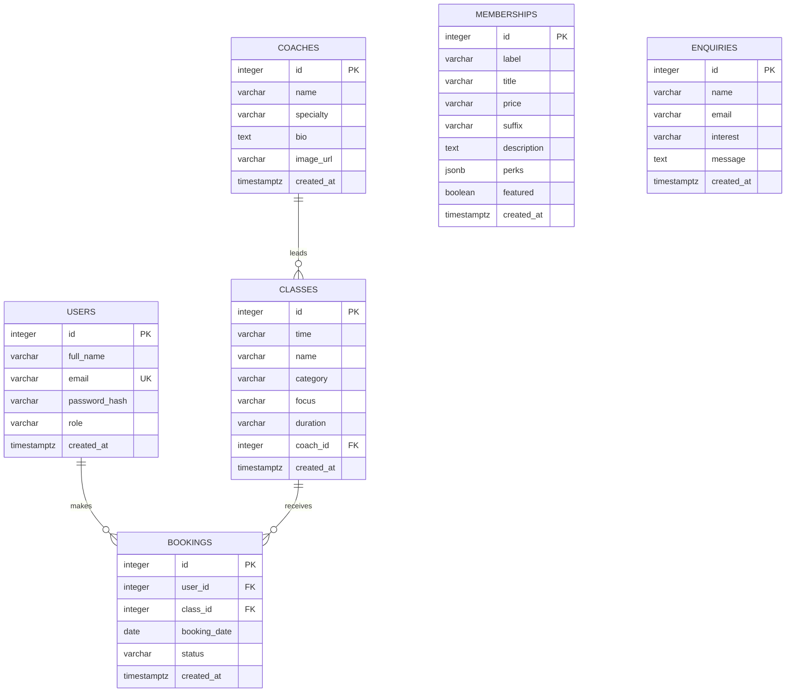

# NRBFIT Database Schema

This document explains the NRBFIT database in plain English. The schema is created by `server/scripts/migrate.js` and stores the studio's members, coaches, timetable, memberships, bookings, and enquiries.

## How The Database Fits Together

- A **coach** can lead many scheduled **classes**.
- A **class** can have many **bookings** from different members.
- A **user** can make many **bookings**.
- A booking belongs to one user and one class.
- **Memberships** and **enquiries** are currently independent records. They do not need a foreign-key link to a user for the initial studio workflow.



## Table Dictionary

### `users`

Stores people who can sign in and reserve classes.

| Column | Type | Required? | Meaning |
| --- | --- | --- | --- |
| `id` | `SERIAL` integer | Yes | Automatically generated identifier for the user. It is the primary key. |
| `full_name` | `VARCHAR(120)` | Yes | The member's displayed name. |
| `email` | `VARCHAR(255)` | Yes | The sign-in email address. It must be unique. |
| `password_hash` | `VARCHAR(255)` | Yes | A bcrypt password hash. The original password is never stored. |
| `role` | `VARCHAR(20)` | Yes | Access level, such as `member` or `admin`. Defaults to `member`. |
| `created_at` | `TIMESTAMP WITH TIME ZONE` | Yes | When the account was created. Defaults to the current time. |

### `coaches`

Stores the studio's coach profiles shown on the public website.

| Column | Type | Required? | Meaning |
| --- | --- | --- | --- |
| `id` | `SERIAL` integer | Yes | Automatically generated coach identifier and primary key. |
| `name` | `VARCHAR(120)` | Yes | Coach's full name. |
| `specialty` | `VARCHAR(120)` | Yes | Main training area, such as strength or mobility. |
| `bio` | `TEXT` | Yes | Longer profile copy describing the coach. |
| `image_url` | `VARCHAR(255)` | No | Path or URL for the coach's portrait. |
| `created_at` | `TIMESTAMP WITH TIME ZONE` | Yes | When the coach record was created. |

### `classes`

Stores each class slot in the studio timetable. The initial seed data contains ten daily slots.

| Column | Type | Required? | Meaning |
| --- | --- | --- | --- |
| `id` | `SERIAL` integer | Yes | Automatically generated class identifier and primary key. |
| `time` | `VARCHAR(10)` | Yes | Display time such as `05:45`. |
| `name` | `VARCHAR(120)` | Yes | Class name, such as `Strength Foundations`. |
| `category` | `VARCHAR(60)` | Yes | Filter group such as `Strength`, `Recovery`, or `Pilates`. |
| `focus` | `VARCHAR(255)` | Yes | Short description of what the class trains. |
| `duration` | `VARCHAR(20)` | Yes | Display duration such as `50 min`. Defaults to `50 min`. |
| `coach_id` | `INTEGER` | No | The coach leading this class. It links to `coaches.id`. If a coach is removed, this value becomes empty rather than deleting the class. |
| `created_at` | `TIMESTAMP WITH TIME ZONE` | Yes | When the class record was created. |

### `memberships`

Stores the plans and class packs that the studio offers.

| Column | Type | Required? | Meaning |
| --- | --- | --- | --- |
| `id` | `SERIAL` integer | Yes | Automatically generated membership identifier and primary key. |
| `label` | `VARCHAR(80)` | Yes | Short plan label, such as `5-class pack`. |
| `title` | `VARCHAR(120)` | Yes | Marketing title shown on the pricing card. |
| `price` | `VARCHAR(30)` | Yes | Formatted price, such as `KES 8,500`. |
| `suffix` | `VARCHAR(30)` | Yes | Price period, such as `/ month` or `/ pack`. |
| `description` | `TEXT` | Yes | Plain-language explanation of the plan. |
| `perks` | `JSONB` | Yes | JSON array of included benefits. Defaults to an empty array. |
| `featured` | `BOOLEAN` | Yes | Whether the plan should be highlighted in the UI. Defaults to `FALSE`. |
| `created_at` | `TIMESTAMP WITH TIME ZONE` | Yes | When the membership record was created. |

### `bookings`

Stores reservations made by members for specific classes on specific dates.

| Column | Type | Required? | Meaning |
| --- | --- | --- | --- |
| `id` | `SERIAL` integer | Yes | Automatically generated reservation identifier and primary key. |
| `user_id` | `INTEGER` | Yes | Member who made the reservation. It links to `users.id`. Deleting the user deletes their bookings. |
| `class_id` | `INTEGER` | Yes | Reserved timetable class. It links to `classes.id`. Deleting the class deletes its bookings. |
| `booking_date` | `DATE` | Yes | Date of the reservation. Defaults to today. |
| `status` | `VARCHAR(20)` | Yes | Reservation state, normally `confirmed` or `cancelled`. Defaults to `confirmed`. |
| `created_at` | `TIMESTAMP WITH TIME ZONE` | Yes | When the reservation was created. |

The application should prevent a member from booking the same class twice on the same date. That rule is enforced by the booking endpoint's business logic rather than by the initial table definition.

### `enquiries`

Stores messages submitted through the public contact form.

| Column | Type | Required? | Meaning |
| --- | --- | --- | --- |
| `id` | `SERIAL` integer | Yes | Automatically generated enquiry identifier and primary key. |
| `name` | `VARCHAR(120)` | Yes | Name supplied by the visitor. |
| `email` | `VARCHAR(255)` | Yes | Email address for the studio team to use when replying. |
| `interest` | `VARCHAR(100)` | Yes | Area the visitor is asking about, such as memberships or classes. |
| `message` | `TEXT` | Yes | Visitor's question or message. |
| `created_at` | `TIMESTAMP WITH TIME ZONE` | Yes | When the enquiry was submitted. |

## Relationships And Rules

### Coach to class

`classes.coach_id` points to `coaches.id`. A coach may lead multiple classes, while each class has zero or one assigned coach. Removing a coach keeps the timetable row but clears its `coach_id` through `ON DELETE SET NULL`.

### User to booking

`bookings.user_id` points to `users.id`. A member may have many bookings. Removing a member removes their bookings through `ON DELETE CASCADE`.

### Class to booking

`bookings.class_id` points to `classes.id`. A class may have many bookings across dates. Removing a class removes its related bookings through `ON DELETE CASCADE`.

## Common Queries

All application values supplied by a visitor or member must be passed as query parameters. Never build SQL by concatenating request values into a query string.

### Book a class

This example creates a confirmed reservation for a member. The booking endpoint should first check that the class exists and that the same member has not already reserved it for that date.

```sql
INSERT INTO bookings (user_id, class_id, booking_date, status)
VALUES ($1, $2, COALESCE($3::date, CURRENT_DATE), 'confirmed')
RETURNING id, user_id, class_id, booking_date, status, created_at;
```

Suggested parameter values:

```text
$1 = authenticated user's id
$2 = selected class id
$3 = requested date, or null to use today
```

### List the timetable by category

This query returns schedule rows with the coach details needed by the public timetable. Passing `NULL` for `$1` returns every category.

```sql
SELECT
  classes.id,
  classes.time,
  classes.name,
  classes.category,
  classes.focus,
  classes.duration,
  coaches.name AS coach_name,
  coaches.specialty AS coach_specialty
FROM classes
LEFT JOIN coaches ON coaches.id = classes.coach_id
WHERE ($1::varchar IS NULL OR classes.category = $1)
ORDER BY classes.time ASC;
```

### Show a member's bookings

```sql
SELECT
  bookings.id,
  bookings.booking_date,
  bookings.status,
  classes.name AS class_name,
  classes.time,
  coaches.name AS coach_name
FROM bookings
JOIN classes ON classes.id = bookings.class_id
LEFT JOIN coaches ON coaches.id = classes.coach_id
WHERE bookings.user_id = $1
ORDER BY bookings.booking_date DESC, classes.time ASC;
```

## Seeding And Migrations

Run the schema migration before seeding content:

```bash
cd server
npm run migrate
npm run seed
```

`migrate` creates tables only when they do not already exist. `seed` uses the natural names of coaches, classes, and membership labels to avoid inserting duplicate studio content when it is run again.
